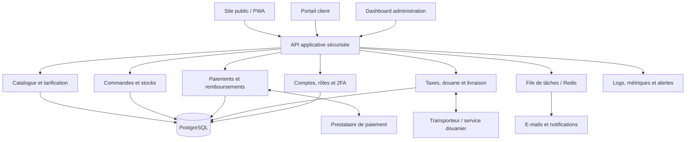

# FANOURS — Cahier des charges fonctionnel, technique et UX/UI

**Projet :** plateforme e-commerce internationale B2B/B2C basée en Chine  
**Nom commercial :** Fanours  
**Version :** 1.0  
**Date :** 21 octobre 2026  
**Statut :** document de référence pour le cadrage, le design, le développement, les tests et la mise en production.

> **Important — conformité et hypothèses.** Ce document définit les exigences à implémenter ; il ne remplace pas l'avis d'un avocat, d'un expert-comptable, d'un déclarant en douane ou d'un prestataire de paiement. Les règles de TVA, douane, importation, sécurité produit, sanctions, protection des données et facturation varient par pays, produit, Incoterm et date. Elles doivent être configurées à partir de sources officielles à jour et validées avant activation commerciale. Aucun tarif douanier ne doit être codé en dur dans l'application.

---

## Sommaire

1. Vision, objectifs et périmètre
2. Publics cibles et modèles commerciaux
3. Identité visuelle, typographie et design system
4. Langues, internationalisation et devises
5. Architecture fonctionnelle et technique
6. Navigation, pages et parcours utilisateur
7. Catalogue produit et gestion des prix
8. Parcours B2B, demande de devis et comptes professionnels
9. Panier, checkout et commandes
10. Paiements, Stripe et réconciliation
11. Douanes, TVA, taxes et conformité d'importation
12. Livraison, logistique, retours et litiges
13. Authentification, comptes et 2FA
14. Notifications, e-mails et factures
15. Dashboard client — centre de contrôle
16. Dashboard administrateur — centre de contrôle complet
17. Contenus, SEO et marketing
18. Recherche, recommandations et fonctionnalités assistées par IA
19. Sécurité applicative et confidentialité
20. Modèle de données
21. API, intégrations et événements
22. Exigences responsive, PWA et accessibilité
23. Performance, disponibilité et observabilité
24. Tests automatisés et E2E
25. Déploiement, environnements et sauvegardes
26. Critères d'acceptation
27. Phasage du projet et livrables
28. Risques, dépendances et décisions à confirmer
29. Sources officielles de référence

---

# 1. Vision, objectifs et périmètre

## 1.1 Vision

Fanours est une boutique basée en Chine qui vend principalement en gros à une clientèle internationale. La plateforme doit permettre de découvrir des produits, comparer les tarifs selon les volumes, acheter des lots professionnels, demander des devis pour les grosses commandes et, lorsque le produit l'autorise, effectuer aussi une commande au détail.

L'expérience attendue doit inspirer confiance : prix lisibles, disponibilité du stock, minimum de commande explicite, délais réalistes, frais estimés avant paiement, politiques de retour accessibles, suivi de commande, documents commerciaux téléchargeables et notifications automatiques.

## 1.2 Objectifs métier

- Développer les ventes en gros à l'international.
- Permettre ponctuellement la vente au détail sans dupliquer la plateforme.
- Réduire les tâches manuelles de traitement des commandes et de support.
- Donner de la visibilité sur le chiffre d'affaires, les marges, le panier moyen, les stocks et les paiements.
- Réduire les abandons grâce à un checkout transparent et mobile-first.
- Afficher des estimations de taxes et de droits à l'importation adaptées au pays de destination, avec une indication claire de la part estimée et de la part définitive.
- Administrer les trois langues principales : français, anglais et chinois simplifié.
- Maintenir des règles douanières, tarifaires et fiscales versionnées, avec une traçabilité des estimations utilisées à la date de la commande.

## 1.3 Périmètre inclus

- Site vitrine et catalogue public.
- Comptes acheteurs individuels et comptes entreprises.
- Vente B2B en gros et vente B2C au détail activable selon le produit ou le canal.
- Prix par volume, MOQ (minimum order quantity), paliers tarifaires et demandes de devis.
- Panier, checkout, paiement, commande, annulation selon statut et remboursement.
- Gestion des expéditions, tracking et documents douaniers.
- Estimation des taxes, droits, frais de courtage et frais d'import lorsque les données et intégrations le permettent.
- Factures et documents commerciaux localisés.
- Notifications transactionnelles par e-mail et centre de notifications dans l'application.
- Authentification sécurisée, MFA/2FA et gestion des sessions.
- Dashboard client et dashboard administrateur.
- Gestion des produits, médias, catégories, stocks, prix, clients, commandes, remboursements, expéditions, litiges et contenus.
- Journal d'audit, analytics, SEO, accessibilité, surveillance et tests automatisés.

## 1.4 Hors périmètre par défaut

- Application native iOS/Android distincte : une PWA installable est prioritaire.
- Marketplace multi-vendeurs : Fanours est le vendeur central dans la version initiale, sauf décision ultérieure.
- Calcul fiscal ou douanier présenté comme garantie légale sans source validée.
- Stockage de numéros de carte bancaire dans la base Fanours.
- Automatisation autonome de décisions juridiques ou de classification douanière sans validation humaine.

## 1.5 Indicateurs de réussite (KPI)

- Taux de conversion visite → panier et panier → commande.
- Taux d'abandon du checkout.
- Part des commandes en gros et panier moyen par segment.
- Chiffre d'affaires, marge brute estimée, nombre de commandes et revenu par pays.
- Taux de paiement réussi, échec et remboursement.
- Délai moyen de préparation, d'expédition et de livraison.
- Taux de réclamation, retour, chargeback et colis bloqué en douane.
- Temps de réponse du support.
- Délivrabilité et taux de rebond des e-mails transactionnels.
- Taux de disponibilité, erreurs applicatives et temps de réponse p95.

---

# 2. Publics cibles et modèles commerciaux

## 2.1 Segments

1. **Acheteur professionnel (B2B)** : revendeur, commerçant, distributeur, entreprise ou acheteur en volume.
2. **Acheteur particulier (B2C)** : commande de petite quantité si la vente au détail est autorisée.
3. **Administrateur** : gestion globale de la plateforme et des accès.
4. **Opérateur catalogue** : produits, variantes, médias, stocks et traductions.
5. **Opérateur logistique** : préparation, colis, expéditions et tracking.
6. **Comptable/finance** : paiements, remboursements, factures, rapprochement et exports.
7. **Support client** : recherche de commandes, réponses, réclamations et litiges.
8. **Gestionnaire conformité** : configuration des destinations, alertes réglementaires, documents et règles d'importation.

## 2.2 Vente en gros par défaut

Le mode principal de Fanours est la vente en gros. Le catalogue doit faire ressortir les minimums de commande, les lots, le prix à l'unité selon le volume, les délais de préparation, la disponibilité et les conditions applicables à l'export.

Pour chaque produit, l'administration peut définir :

- `sales_modes`: `wholesale`, `retail`, ou les deux ;
- MOQ globale et MOQ par variante ;
- incrément de quantité autorisé (multiple de 6, 12, 24, etc.) ;
- paliers de prix et devise de référence ;
- prix public indicatif, prix grossiste standard et prix négocié par client ;
- quantités disponibles, stock de sécurité et délai de réapprovisionnement ;
- pays interdits ou soumis à une approbation ;
- documents/certifications requis pour vendre ou expédier le produit.

## 2.3 Activation du détail

La vente au détail est configurable par produit, pays et canal commercial. Si elle est désactivée, le site ne doit pas afficher de bouton « Acheter à l'unité » ni permettre de contourner le minimum de commande via l'API.

## 2.4 Règles d'autorisation

Les droits sont appliqués côté serveur, et non uniquement par masquage d'éléments d'interface. Toute route, action API, export ou document sensible doit vérifier le rôle, le propriétaire de la ressource et les permissions associées.

---

# 3. Identité visuelle, typographie et design system

## 3.1 Positionnement de marque

**Fanours — Un peu de rose. Beaucoup de style. Je craque.**

L'identité doit évoquer la beauté, la douceur, la modernité et la confiance commerciale. Le rose bonbon est la couleur signature, mais l'ensemble doit rester premium, professionnel et adapté à un portail B2B.

## 3.2 Typographies

### Plus Jakarta Sans

Utilisation : titres, accroches, nom de marque, navigation et titres de sections.

Graisses recommandées : 500, 600, 700 et 800.

Exemple :

> Un peu de rose.  
> Beaucoup de style.  
> Je craque.

### Inter

Utilisation : paragraphes, formulaires, prix, tableaux, listes, statuts, dashboard et documentation opérationnelle.

Graisses recommandées : 400, 500, 600 et 700.

### Chinois simplifié

Utiliser une police CJK adaptée, par exemple Noto Sans SC, puis des polices de secours du système. Vérifier la largeur des boutons, les retours à la ligne et les caractères dans les PDF générés.

### Exigences d'implémentation

- Déclarer `--font-heading` et `--font-body` dans les tokens CSS.
- Fournir des fallbacks système.
- Employer `font-display: swap`.
- Charger uniquement les graisses effectivement utilisées.
- Limiter le préchargement aux fichiers critiques.
- Tester les trois langues pour prévenir les débordements typographiques.

## 3.3 Palette principale

### Mode clair

| Rôle | Valeur | Usage |
|---|---|---|
| Fond | `#FFF5FA` | Fond global légèrement rosé |
| Surface | `#FFFFFF` | Cartes, menus, panneaux et formulaires |
| Texte | `#321526` | Texte principal |
| Primaire | `#D81B75` | CTA, liens clés et sélection |
| Accent | `#FFD6EA` | Fonds décoratifs et éléments sélectionnés |
| Surface secondaire | `#F7DCE9` | Sections secondaires |

### Mode sombre

| Rôle | Valeur | Usage |
|---|---|---|
| Fond | `#180D15` | Fond global |
| Surface | `#261420` | Cartes et panneaux |
| Texte | `#FFF0F7` | Texte principal |
| Primaire | `#FF70B7` | CTA et liens actifs |
| Accent | `#4B1F39` | Surfaces accentuées |
| Surface élevée | `#35202D` | Menus, popovers et éléments flottants |

### Nuances dérivées recommandées

| Token | Light | Dark | Usage |
|---|---|---|---|
| Rose 50 | `#FFF5FA` | `#2A1421` | Fonds les plus subtils |
| Rose 100 | `#FFE8F2` | `#35182A` | Surfaces douces |
| Rose 200 | `#FFD6EA` | `#4B1F39` | Accent et sélection |
| Rose 300 | `#FFB5D6` | `#7A2A52` | Hover décoratif |
| Rose 400 | `#F58AB9` | `#C84B88` | Accent intermédiaire |
| Rose 500 | `#E84393` | `#E95B9E` | Accent secondaire |
| Rose 600 | `#D81B75` | `#FF70B7` | Primaire |
| Rose 700 | `#B91662` | `#FF9CCB` | États actifs |
| Rose 800 | `#8F124F` | `#FFC2DE` | Texte d'accentuation |
| Rose 900 | `#64103A` | `#FFE0EF` | Contraste profond |

Ces nuances sont des tokens de design proposés ; vérifier le contraste réel de chaque couple texte/fond avant publication.

## 3.4 Couleurs fonctionnelles

| État | Light | Dark | Usage |
|---|---|---|---|
| Succès | `#16794B` | `#4ADE80` | Paiement accepté, expédition confirmée |
| Attention | `#9A5B00` | `#FBBF24` | Stock bas, document requis |
| Erreur | `#B42336` | `#FF6B7A` | Échec de paiement, erreur de validation |
| Information | `#2458B8` | `#7CA7FF` | Information logistique ou compte |
| Neutre | `#667085` | `#B8A8B3` | Métadonnées |
| Bordure | `#F0DCE6` | `#49303E` | Séparateurs et contours |

Un statut ne doit jamais dépendre de la seule couleur : associer texte, icône et/ou description.

## 3.5 Gradients

- Hero clair : `linear-gradient(135deg, #FFF5FA 0%, #FFD6EA 55%, #FFFFFF 100%)`
- Hero sombre : `linear-gradient(135deg, #180D15 0%, #35182A 55%, #4B1F39 100%)`
- CTA clair : `linear-gradient(135deg, #D81B75 0%, #F04C9A 100%)`
- CTA sombre : `linear-gradient(135deg, #FF70B7 0%, #FF9CCB 100%)`

## 3.6 Glassmorphism et flou

- Surfaces vitrées de 70 à 90 % d'opacité selon le fond.
- `backdrop-filter: blur(12px)` à `blur(20px)` pour les panneaux principaux.
- Bordure translucide de 1 px et ombre légère.
- Prévoir un fond opaque de secours si le blur n'est pas supporté.
- Ne pas placer de texte critique sur une image ou un décor animé sans fond de contraste.
- Limiter les zones floutées simultanées sur mobile pour les performances.
- Les zones de paiement, de connexion, de sécurité et les tableaux opérationnels doivent privilégier la lisibilité plutôt que les effets décoratifs.

## 3.7 Principes des composants

- Boutons d'une hauteur de 44 à 48 px minimum, avec état normal, hover, focus, actif, désactivé et chargement.
- Cartes produit avec image, variante, stock, prix par palier, MOQ et délai de préparation.
- Champs de formulaire avec label persistant, indication d'erreur et description accessible.
- Modales centrées sur desktop et bottom sheets/panneaux plein écran sur mobile.
- Skeleton loaders correspondant à la structure finale.
- Toasts discrets et lisibles, avec possibilité de les fermer.
- Focus clavier visible et navigation cohérente.
- Mouvement réduit lorsque `prefers-reduced-motion` est activé.

## 3.8 Thème

Trois options : clair, sombre ou automatique selon le système. La préférence est persistée sur l'appareil et synchronisée au compte après connexion. Le panier, le checkout, le portail client et le dashboard doivent conserver le thème choisi. Les pages de paiement hébergées par le prestataire auront les seules personnalisations que celui-ci autorise.

---

# 4. Langues, internationalisation et devises

## 4.1 Langues obligatoires

- Français (`fr-FR`)
- Anglais (`en` ou locale anglaise définie au lancement)
- Chinois simplifié (`zh-CN`)

Le choix de langue est accessible dans l'en-tête, le pied de page, les préférences du compte et, lorsque possible, dans le checkout.

## 4.2 Exigences de traduction

- Toutes les chaînes visibles proviennent de dictionnaires de traduction, sans texte utilisateur codé en dur dans les composants.
- Les pages transactionnelles, erreurs, e-mails, factures, boutons, mentions légales et statuts de commande doivent être traduits.
- Prévoir une langue de secours explicite si une traduction manque.
- Le contenu administrable (description, avantages, FAQ, politiques) est stocké par locale.
- Enregistrer la langue utilisée pour les e-mails et documents au moment où ils sont produits.
- Les commandes déjà passées conservent une copie des conditions et du texte commercial présenté au moment de l'achat.
- Les traductions chinoises sont relues par une personne compétente ; éviter la traduction machine non relue pour les conditions juridiques, la sécurité et les consignes douanières.

## 4.3 Devises

- Devise de référence du back-office configurable, par exemple CNY ou USD après validation comptable.
- Prix affichables dans plusieurs devises si un fournisseur de taux fiable est intégré.
- Stocker séparément le montant de référence, la devise de transaction, le taux et l'horodatage utilisés.
- Montrer lorsqu'un montant converti est indicatif et que la banque ou le prestataire peut appliquer un taux différent.
- Ne pas confondre devise d'affichage et devise réellement débitée.
- Tous les calculs monétaires se font en unités mineures entières ou décimales exactes adaptées à la devise, jamais en flottants binaires non maîtrisés.
- Afficher les montants selon les conventions locales, avec code de devise explicite lorsque nécessaire.

## 4.4 Formats locaux

Gérer correctement dates, fuseaux horaires, nombres, adresses, téléphones internationaux, codes postaux et formats de sociétés. Conserver les timestamps en UTC et afficher l'heure dans le fuseau de l'utilisateur ou du lieu logistique, en précisant le contexte.

---

# 5. Architecture fonctionnelle et technique

## 5.1 Architecture cible

Architecture modulaire, maintenable et sécurisée. Une architecture de monolithe modulaire avec séparation claire des domaines est recommandée au démarrage : elle limite la complexité opérationnelle sans empêcher une évolution ultérieure.

### Pile technique de référence

- **Frontend :** Next.js avec TypeScript et App Router.
- **UI :** Tailwind CSS, tokens CSS centralisés, composants accessibles et bibliothèque d'icônes cohérente.
- **Backend :** NestJS/TypeScript ou backend structuré équivalent avec validation des schémas, RBAC et documentation OpenAPI.
- **Base de données :** PostgreSQL.
- **ORM :** Prisma ou Drizzle ; choisir un seul ORM au lancement.
- **Cache et tâches :** Redis et file de tâches pour e-mails, webhooks, exports et traitements asynchrones.
- **Fichiers :** stockage objet compatible S3 avec CDN pour les images et documents autorisés.
- **Recherche :** moteur PostgreSQL au lancement, puis moteur dédié si le volume l'exige.
- **E-mails :** fournisseur transactionnel avec SPF, DKIM et DMARC configurés.
- **Paiement :** Stripe si l'entité marchande et l'activité sont éligibles ; sinon un prestataire autorisé pour la juridiction de Fanours.
- **Observabilité :** logs structurés, métriques, suivi d'erreurs et alertes.
- **Tests :** Vitest/Jest, Testing Library, tests API et Playwright pour les scénarios E2E.

La pile ci-dessus est une recommandation de référence et doit être confirmée selon l'équipe, l'hébergement, la juridiction et les intégrations retenues.

## 5.2 Modules métier

1. Identité, authentification et autorisations.
2. Catalogue, catégories, variantes et médias.
3. Tarification B2B/B2C, MOQ et devis.
4. Panier, checkout et commandes.
5. Paiement, remboursement et rapprochement.
6. Stock, approvisionnement et réservation.
7. Livraison, tracking et documents d'export.
8. Moteur de taxes, douane et restrictions d'importation.
9. Facturation et documents commerciaux.
10. Notifications et modèles e-mail.
11. Gestion clients, validation professionnelle et support.
12. Contenu, SEO et marketing.
13. Dashboard client.
14. Dashboard administrateur.
15. Audit, sécurité, analytics et observabilité.

## 5.3 Schéma d'échange simplifié

## 5.4 Principes d'architecture

- Séparer logique métier, accès données et présentation.
- Ne jamais considérer le frontend comme source de vérité pour les prix, taxes, frais ou autorisations.
- Toutes les mutations sensibles sont validées côté serveur.
- Mettre en place une gestion des erreurs normalisée et des identifiants de corrélation.
- Rendre idempotentes les opérations sensibles, en particulier paiement, webhook, commande et remboursement.
- Garder l'historique des changements de prix, de règles fiscales, de stock et de statut.
- Éviter les microservices prématurés ; isoler les modules par domaine pour faciliter leur séparation éventuelle.

---

# 6. Navigation, pages et parcours utilisateur

## 6.1 Pages publiques

- Accueil.
- Catalogue complet.
- Catégories et sous-catégories.
- Résultats de recherche.
- Fiche produit.
- À propos de Fanours.
- Comment fonctionne la vente en gros.
- Demande de devis professionnel.
- Guides d'achat et de commande internationale.
- Centre d'aide / FAQ.
- Contact et support.
- Suivi de commande par lien sécurisé.
- Politiques de livraison, retours, remboursements, confidentialité et cookies.
- Conditions générales de vente B2B et B2C applicables selon le marché.
- Informations sur taxes, douanes, garanties, exclusions et restrictions.
- Pages 404, 500, maintenance et accès refusé.

## 6.2 Accueil

Sections recommandées :

1. En-tête contenant logo, recherche, catégories, sélecteur de langue, devise, compte et panier.
2. Hero éditorial : « Un peu de rose. Beaucoup de style. Je craque. »
3. CTA principal « Explorer le catalogue » et CTA secondaire « Acheter en gros ».
4. Catégories principales avec visuels et navigation rapide.
5. Produits populaires et nouveautés.
6. Bloc « Prix dégressifs selon vos volumes » avec exemple transparent.
7. Bloc consacré à la livraison internationale et aux frais d'importation.
8. Engagements vérifiables : support, contrôle qualité ou sécurité uniquement si Fanours peut effectivement les garantir.
9. Guide d'achat grossiste en quelques étapes.
10. Avis clients authentiques, sans faux témoignages.
11. FAQ courte.
12. Inscription à la newsletter avec consentement approprié.
13. Footer avec langue, contact, politiques et informations d'entreprise.

## 6.3 Catalogue

- Grille responsive de produits.
- Recherche textuelle avec suggestions.
- Filtres : catégorie, disponibilité, prix, vente en gros/détail, MOQ, quantité, variantes, pays d'expédition et autres attributs pertinents.
- Tri par pertinence, nouveauté, prix et popularité calculée selon une mesure documentée.
- Affichage du prix unitaire correspondant à un palier explicite.
- État vide avec proposition de retirer des filtres.
- Pagination ou chargement progressif accessible ; éviter le scroll infini inaccessible.
- URL partageable avec les paramètres de recherche et filtres.
- Les filtres et données doivent être validés côté serveur.

## 6.4 Fiche produit

Doit afficher :

- Nom, référence/SKU, catégorie et disponibilité.
- Galerie d'images, zoom accessible et alt text.
- Description courte et longue, attributs et spécifications.
- Variantes, couleurs, dimensions, matériaux, poids et conditionnement si pertinents.
- MOQ et incrément de commande.
- Tableau de prix dégressifs avec quantités et devise.
- Quantité saisissable, validation des multiples et prix total.
- Délai de préparation estimé, distinct du délai de transport.
- Pays de destination admissibles et restrictions connues.
- Poids et dimensions nécessaires au calcul de transport et à la douane.
- Documents de conformité/certifications applicables, si disponibles.
- Estimation de livraison et de coûts d'import lorsque les informations sont suffisantes.
- Conditions de retour et garantie applicables.
- CTA « Ajouter au panier », « Demander un devis » ou « Contacter l'équipe » selon le cas.
- Produits comparables et suggestions pertinentes.

L'estimation douanière doit être marquée comme indicative tant que le montant final ne peut pas être garanti par un prestataire autorisé.

## 6.5 Parcours type d'achat

1. L'utilisateur découvre un produit.
2. Il choisit langue, pays de destination et mode de vente si pertinent.
3. Il sélectionne ses variantes et quantité.
4. L'application valide MOQ, multiples, stock et prix par palier.
5. Le panier recalcule les prix depuis le serveur.
6. L'utilisateur fournit ou confirme son adresse.
7. Le système calcule ou estime transport, taxes et frais d'import.
8. Le checkout affiche un récapitulatif clair, les Incoterms lorsqu'ils sont applicables et qui paiera les droits à destination.
9. L'acheteur accepte les conditions appropriées.
10. Le paiement est initié chez le prestataire.
11. Le backend attend la confirmation vérifiée du prestataire/webhook avant de confirmer définitivement le paiement.
12. La commande est confirmée selon les règles de paiement/commande.
13. La facture ou le reçu applicable est produit.
14. L'acheteur reçoit un e-mail et une notification dans son compte.
15. Les opérateurs préparent, expédient et mettent à jour le tracking.
16. L'acheteur suit la commande jusqu'à livraison ou ouverture d'un litige.

## 6.6 États de chargement, d'erreur et de vide

Chaque page doit traiter explicitement : chargement, absence de résultat, accès refusé, erreur réseau, session expirée, ressource indisponible, conflit de stock, quantité invalide, paiement en attente et interruption du prestataire. Les messages doivent être localisés, compréhensibles et ne pas exposer de données techniques ou sensibles.

---

# 7. Catalogue produit et gestion des prix

## 7.1 Données produit

Chaque produit possède au minimum :

- Identifiant stable, nom, slug et SKU.
- Descriptions par langue.
- Catégories, tags et attributs structurés.
- Images, vidéos éventuelles, ordre d'affichage et texte alternatif.
- Variantes et SKU de variante.
- Modes de vente autorisés.
- MOQ, multiple de commande et éventuels plafonds.
- Paliers de tarification.
- Coût d'achat et coûts logistiques internes, avec accès restreint.
- Prix public et prix grossiste selon le canal.
- Disponibilité, stock disponible, stock réservé et seuil d'alerte.
- Poids net/brut, dimensions, emballage et pays d'origine.
- Code SH/HS suggéré, avec statut de validation et justification/source.
- Restrictions d'export/import, documents et certifications applicables.
- Statut brouillon, en révision, publié, suspendu ou archivé.
- Date de création, mise à jour, auteur et historique des modifications.

## 7.2 Prix dégressifs

Le système doit prendre en charge des tranches non chevauchantes et sans ambiguïté, par exemple :

| Quantité commandée | Prix unitaire indicatif |
|---:|---:|
| 1–9 unités | 15,00 |
| 10–49 unités | 12,00 |
| 50–99 unités | 10,50 |
| 100 unités et plus | 9,00 |

Ces montants ne sont que des exemples d'interface, pas les tarifs réels de Fanours.

Exigences :

- Définir les limites inclusives de chaque palier.
- Déterminer précisément si le palier s'applique par SKU, variante, famille ou ensemble de lignes.
- Recalculer le palier dès que la quantité change.
- Enregistrer un instantané du prix et de la règle appliquée dans la commande.
- Contrôler les prix négociés, les dates d'expiration et les devises.
- Prévenir tout prix négatif, incohérent ou pouvant être manipulé par le client.

## 7.3 Stock et réservations

- Distinguer disponible, réservé, endommagé, en contrôle et en réapprovisionnement.
- Réserver temporairement le stock pendant un checkout selon une durée configurable.
- Relâcher la réservation après expiration ou échec définitif.
- Utiliser une transaction ou un verrou adapté pour empêcher les surventes concurrentes.
- Réconcilier régulièrement les quantités avec les outils logistiques physiques.
- Autoriser la précommande uniquement si elle est explicitement activée et que sa date est claire.
- Alertes de stock bas et historique des mouvements avec motif et utilisateur.

## 7.4 Import/export catalogue

L'administration peut importer/exporter les données autorisées via CSV/XLSX avec aperçu préalable, validation de schéma, rapport d'erreur par ligne et possibilité d'annuler un import tant qu'il n'a pas déclenché de conséquences irréversibles. Les imports ne doivent jamais écraser silencieusement les champs de conformité ou les prix validés.

---

# 8. Parcours B2B, demande de devis et comptes professionnels

## 8.1 Profil professionnel

Le compte entreprise peut contenir :

- Raison sociale et nom commercial.
- Pays d'établissement et adresse de facturation.
- Identifiant d'entreprise ou de taxe lorsque juridiquement nécessaire.
- Contact principal, e-mail, téléphone et rôle dans l'entreprise.
- Adresse de livraison et adresses secondaires.
- Langue, devise préférée et préférences de notification.
- Statut : non vérifié, en attente, approuvé, refusé, suspendu.
- Documents soumis lorsque nécessaires et autorisés.
- Limites de commande, conditions tarifaires et historique de validation.

La collecte de données doit être proportionnée et liée à un objectif légitime. Ne pas demander un justificatif sans nécessité. Les fichiers sensibles doivent être chiffrés, accessibles uniquement aux rôles autorisés et supprimés conformément à la politique de conservation.

## 8.2 Vérification professionnelle

- Formulaire de demande d'accès aux tarifs professionnels.
- Contrôles manuels ou via un fournisseur autorisé, selon les besoins.
- File d'attente pour approbation avec notes internes et historique.
- Décision motivée et notification localisée.
- Possibilité de réclamer des informations complémentaires.
- Pas d'activation définitive sur la seule base d'une donnée facilement falsifiable.
- Journaliser qui a approuvé, refusé ou modifié un statut.

## 8.3 Demande de devis

L'acheteur peut demander un devis en précisant produits, variantes, quantités, destination, mode d'expédition, besoins spécifiques et délai souhaité.

Fonctionnalités :

- Création d'un numéro de devis unique.
- Statuts : brouillon, envoyé, consultation, négociation, accepté, refusé, expiré, converti en commande.
- Prix, paliers, remises autorisées, transport et validité clairement visibles.
- Conditions de paiement et Incoterm proposés, si validés.
- Commentaires client et échanges internes.
- Historique de chaque révision du devis.
- Acceptation explicite par un utilisateur autorisé.
- Conversion en commande sans ressaisie, en conservant l'instantané accepté.
- Notification à l'acheteur et à l'équipe commerciale à chaque étape clé.

## 8.4 Tarification spécifique par client

Autoriser une grille de prix contractuelle ou une remise négociée avec dates de validité, approbation interne et historique. Les règles prioritaires entre prix standard, prix de groupe, prix client et promotion doivent être définies et testées, pas improvisées au moment du calcul.

---

# 9. Panier, checkout et commandes

## 9.1 Panier

- Panier invité et panier lié au compte.
- Fusion contrôlée du panier invité après connexion.
- Modification de quantité, suppression de ligne et sélection de variantes.
- Affichage MOQ, palier actif, disponibilité et délai de préparation.
- Estimation du coût de transport et des importations dès que l'adresse est suffisamment précise.
- Sauvegarde durable pour les comptes connectés.
- Gestion des produits qui deviennent indisponibles entre ajout et paiement.
- Recalcul serveur obligatoire à chaque action déterminante.
- Code promotionnel avec conditions, expiration et journal d'utilisation.
- Pas de frais cachés ajoutés après le consentement final.

## 9.2 Checkout

Étapes recommandées, adaptées au mobile :

1. Coordonnées de contact.
2. Adresse de livraison et de facturation.
3. Pays, type d'acheteur et champs d'importateur requis.
4. Méthode et prix de livraison.
5. Taxes, droits et frais estimés ou confirmés.
6. Sélection du mode de paiement.
7. Vérification complète de la commande.
8. Acceptation des conditions applicables et confirmation.

Le checkout doit permettre de comprendre : devise débitée, total produit, remise, transport, taxes collectées par Fanours, droits/débours éventuels à payer au transporteur, éventuels frais d'import et identité de la partie responsable du dédouanement.

## 9.3 États de commande

États métier à définir, par exemple :

- `draft`
- `pending_payment`
- `payment_processing`
- `paid`
- `payment_failed`
- `awaiting_review`
- `confirmed`
- `processing`
- `partially_fulfilled`
- `shipped`
- `in_transit`
- `customs_action_required`
- `delivered`
- `completed`
- `cancellation_requested`
- `cancelled`
- `refund_pending`
- `partially_refunded`
- `refunded`
- `disputed`

Les transitions autorisées sont codifiées. Une livraison ne peut pas être marquée comme expédiée sans expédition associée. Un remboursement n'est pas déduit du seul clic d'un administrateur : il doit être confirmé par le prestataire. Une commande payée ne doit pas être supprimée ; elle demeure dans l'historique d'audit.

## 9.4 Annulation et modification

- Règles d'annulation selon l'état de préparation/expédition et les conditions applicables.
- Déterminer si une annulation entraîne un remboursement total ou partiel.
- Une commande déjà expédiée ne peut pas être annulée de la même manière qu'une commande non préparée.
- Les modifications après paiement sont enregistrées et réévaluées par rapport aux taxes, au transport et aux documents douaniers.
- Toute modification du montant doit passer par un mécanisme de paiement autorisé.

## 9.5 Protection contre les doubles commandes

- Clés d'idempotence sur la création de commande et les opérations de paiement.
- Verrou ou contrainte unique lors de la confirmation.
- Webhooks signés, vérifiés et traités de manière idempotente.
- Traitements asynchrones rejouables sans dupliquer facture, stock, notification ou remboursement.

---

# 10. Paiements, Stripe et réconciliation

## 10.1 Exigence de décision préalable

Stripe doit être utilisé uniquement si l'entité juridique de Fanours, le pays d'établissement du marchand, le compte bancaire, l'activité et les documents sont éligibles. La Chine continentale ne doit pas être considérée par défaut comme un pays d'ouverture de compte Stripe pris en charge ; la disponibilité actuelle diffère selon les pays et Hong Kong figure séparément dans la liste officielle. Il ne faut pas contourner les contrôles de résidence, d'entité ou de conformité. Voir les sources officielles en section 29.

Si Stripe n'est pas accessible légalement et commercialement à Fanours, sélectionner un prestataire de paiement autorisé dans la juridiction réelle de l'entreprise et compatible avec les paiements internationaux. L'architecture doit encapsuler le fournisseur derrière une interface interne afin d'éviter de réécrire tout le checkout.

## 10.2 Moyens de paiement

À sélectionner après validation du prestataire :

- Cartes bancaires internationales.
- Authentification forte/3-D Secure lorsqu'elle est applicable.
- Méthodes locales prises en charge par marché, si justifiées.
- Virement bancaire pour certaines commandes B2B, avec rapprochement manuel ou automatisé.
- Paiement sur facture uniquement pour les clients approuvés et avec une limite de crédit explicite.

Ne jamais afficher un moyen de paiement qui n'est pas activé pour la combinaison pays/devise/commande concernée.

## 10.3 Exigences d'intégration

- Utiliser les composants hébergés/tokenisés du prestataire pour les données de carte.
- Ne pas stocker PAN complet, CVV ou données de carte dans les logs, base de données ou analytics.
- Vérifier les signatures des webhooks.
- Enregistrer identifiant de transaction, devise, montant, statut fournisseur et dates utiles.
- Réconcilier quotidiennement les paiements, remboursements et versements.
- Traiter les paiements asynchrones : en attente, accepté, refusé, expiré, contesté.
- Gestion des paiements partiels ou des acomptes seulement si la politique commerciale le prévoit.
- Afficher au client une référence de paiement, jamais les données confidentielles du prestataire.
- Mettre en place une procédure de gestion des chargebacks et demandes de preuve.

## 10.4 Remboursements

- Remboursement total ou partiel avec motif requis.
- Autorisations restreintes aux rôles finance/administration désignés.
- Confirmation du statut via le prestataire.
- Mise à jour du montant remboursé sans écraser le montant d'origine.
- Génération d'un avoir ou document correctif si nécessaire juridiquement.
- Notifications au client.
- Journalisation de l'auteur, de la raison, du montant et de la référence externe.

## 10.5 Tableau de rapprochement

Filtres par période, commande, client, pays, devise, moyen, statut, identifiant externe, remboursements, frais du prestataire et écarts. Export CSV limité aux rôles autorisés. Tout écart doit pouvoir être annoté, attribué à un opérateur et suivi jusqu'à résolution.

---

# 11. Douanes, TVA, taxes et conformité d'importation

Cette section est critique pour une boutique en Chine dont les acheteurs sont en majorité situés hors de Chine. Le but est d'informer l'acheteur avant paiement, de produire des données fiables pour le transporteur et de réduire les blocages à la frontière. Les calculs définitifs peuvent relever du transporteur, du courtier en douane, du système fiscal ou des autorités du pays de destination.

## 11.1 Principe général

Le système doit identifier, pour chaque destination et produit :

- Qui est l'exportateur, l'importateur officiel et le déclarant.
- Le pays d'origine, pays d'expédition et pays de destination.
- La nature réelle du produit, composition, usage, valeur, poids et quantité.
- Le code tarifaire HS/SH, validé ou provisoire, et le niveau de confiance/source.
- Les restrictions, certifications et documents obligatoires.
- Le régime de taxe et les responsabilités selon le marché, le type d'acheteur et l'Incoterm.
- L'estimation du transport, des droits, taxes, frais de courtage et frais de dossier éventuels.

Ne jamais suggérer une valeur douanière inférieure à la valeur réelle, une fausse catégorie, une fausse origine ou un fractionnement artificiel de colis destiné à contourner des règles.

## 11.2 Moteur de règles configurables

Créer un module `TradeCompliance` qui sépare les règles du code applicatif. Chaque règle contient :

- Pays ou territoire concerné.
- Catégories ou codes produits visés.
- Date de début et, si applicable, date de fin.
- Source officielle, URL et date de consultation.
- Type de règle : TVA, droit, seuil, frais forfaitaire, licence, interdiction, documentation ou avertissement.
- Mode de calcul, base taxable et éventuels seuils.
- Niveau de certitude : validé, estimatif, incomplet ou nécessitant un spécialiste.
- Responsable de validation et date de dernière révision.
- Historique de modification et versions précédentes.

Les règles expirées ne doivent pas s'appliquer silencieusement. Une alerte est envoyée au gestionnaire conformité lorsque la révision est échue.

## 11.3 Modèle de calcul

Le calcul doit être traçable et explicable. Selon le pays, les composantes possibles comprennent :

1. Valeur des marchandises.
2. Remises reconnues par le régime applicable.
3. Transport et assurance, lorsque requis dans la base de calcul.
4. Droits de douane selon le classement, l'origine et le régime.
5. TVA/GST et autres taxes d'importation selon la base légalement applicable.
6. Frais de courtage/dédouanement du transporteur.
7. Frais administratifs ou frais réglementaires applicables.
8. Taxes éventuellement collectées au checkout par Fanours ou son intermédiaire.

Ne pas additionner deux fois une taxe déjà collectée. Ne pas présenter toutes les lignes comme certaines lorsque les données sont incomplètes. Donner une fourchette ou afficher « à confirmer par le transporteur/les autorités » lorsqu'une estimation fiable n'est pas possible.

## 11.4 Affichage côté acheteur

Sur la fiche produit, le panier et le checkout :

- Sélecteur ou détection du pays de destination, toujours modifiable.
- Estimation du transport, taxes et droits selon les données disponibles.
- Distinguer les frais payés à Fanours des sommes potentiellement collectées à la livraison.
- Expliquer qui est responsable des formalités et des frais d'import.
- Afficher les documents ou identifiants que l'acheteur devra fournir, selon le cas.
- Indiquer si une livraison DDP (droits acquittés) est réellement disponible ou si la livraison est DAP (droits non acquittés) ou sous un autre Incoterm convenu.
- Ne jamais choisir ou annoncer un Incoterm comme promesse commerciale tant que Fanours n'a pas contractuellement mis en place l'organisation correspondante.
- Demander une confirmation explicite lorsque des frais supplémentaires raisonnablement prévisibles seront payés à l'arrivée.
- Enregistrer l'estimation, sa source, sa version, son horodatage et le texte présenté au client au moment de l'achat.

## 11.5 Codes HS/SH et origine

- Stocker le code HS/SH validé, sa version et l'autorité/source utilisée.
- Séparer code suggéré automatiquement du code confirmé par le responsable.
- Décrire les caractéristiques factuelles du produit nécessaires au classement.
- Stocker le pays d'origine réel séparément du pays d'expédition.
- Prévoir un blocage ou une revue manuelle si le code est absent, incertain ou soumis à des règles particulières.
- Aucune IA ne peut confirmer seule un classement douanier définitif.

## 11.6 Pays et restrictions

Créer un référentiel de pays avec :

- Disponibilité de livraison.
- Transporteurs et services accessibles.
- Restrictions produit par catégorie.
- Exigences d'identification fiscale ou d'importateur, si nécessaires.
- Documents commerciaux et douaniers requis.
- Règles de taxes et d'importation versionnées.
- Devises et modes de paiement activés.
- Avertissements et statut opérationnel.

Il doit être possible de désactiver un pays ou une catégorie de produits en urgence, avec justification et audit.

## 11.7 Exemples de zones à couvrir

L'administrateur de conformité doit créer des profils initiaux pour les principaux marchés réels de Fanours, par exemple : Union européenne, Royaume-Uni, États-Unis, Canada, Australie et pays africains prioritaires. La prise en charge effective dépendra des marchandises et des services logistiques disponibles. Aucun pays ne doit être considéré automatiquement couvert avant validation.

### Union européenne

- Gérer les obligations TVA applicables aux importations et ventes à distance selon le modèle retenu.
- Évaluer l'éligibilité et les obligations associées à IOSS/OSS avec un fiscaliste, le cas échéant.
- Ne pas supposer qu'un seuil de faible valeur signifie absence de TVA ou absence de formalités douanières.
- Actualiser les règles à la date d'entrée en vigueur des textes. À la date de ce document, la Commission européenne publie des informations évolutives sur les règles e-commerce et les mesures applicables à certaines importations de faible valeur ; une règle temporaire européenne de 3 € par article pour certains envois de faible valeur est indiquée comme applicable à partir du 1er juillet 2026 jusqu'au 1er juillet 2028, sous réserve de son champ d'application et des textes définitifs. Son traitement doit être confirmé pour chaque scénario avec les sources officielles.
- Pour chaque livraison vers l'UE, estimer les coûts uniquement à partir du code tarifaire, de la valeur et du régime applicable ; ne pas appliquer mécaniquement une règle forfaitaire à tous les produits.

### Royaume-Uni

- Traiter séparément la TVA, les règles d'importation, les seuils et les exigences de déclarations britanniques, qui ne sont pas identiques à celles de l'UE.
- Utiliser une source officielle britannique à jour et distinguer Grande-Bretagne et autres territoires lorsque cela a un impact légal ou logistique.

### États-Unis, Canada, Australie et autres marchés

- Gérer les règles selon la juridiction, la valeur, le type de marchandise, l'origine, la méthode de transport et les règles actives à la date de livraison.
- Les seuils de minimis, exclusions et taxes peuvent évoluer ; aucun seuil ne doit être codé en dur sans date de validité et source.
- Prévoir une revue particulière pour produits réglementés, textiles, cosmétiques, appareils électriques, jouets, batteries, produits chimiques ou produits en contact avec les aliments.

## 11.8 Documents d'expédition et de douane

Selon le type de marchandise et le transporteur :

- Facture commerciale.
- Liste de colisage (packing list).
- Déclaration d'exportation si nécessaire.
- Étiquette et lettre de transport.
- Certificat d'origine si applicable.
- Documents ou certifications de sécurité/conformité.
- Informations douanières structurées destinées au transporteur.
- Preuve de valeur, transaction et paiement si demandée légalement.

La génération des documents doit réutiliser les données validées de la commande et enregistrer la version envoyée. La facture commerciale d'export ne doit pas être confondue automatiquement avec une facture fiscale locale.

## 11.9 Contrôle et alertes douanières

- Drapeau « données douanières incomplètes » avant confirmation d'une expédition.
- Blocage explicite si un produit est interdit ou si un document obligatoire manque.
- Alerte si code HS non confirmé, origine manquante ou valeur incohérente.
- Statut « action requise par l'importateur » pour un document ou paiement manquant.
- Journal des incidents, frais supplémentaires, colis retenus et causes.
- Escalade au support et notification au client.

## 11.10 Limites et responsabilité

Le site doit expliquer que les estimations ne remplacent pas une décision des douanes ou un avis professionnel lorsque les montants ne sont pas garantis. Les conditions de vente doivent préciser de manière conforme au droit applicable les responsabilités de Fanours, de l'acheteur, du transporteur et du déclarant. Les mentions ne doivent pas chercher à exclure illégalement les droits impératifs du consommateur.

---

# 12. Livraison, logistique, retours et litiges

## 12.1 Modes d'expédition

- Intégration à un ou plusieurs transporteurs internationaux choisis après négociation.
- Options express, standard, économique ou fret pour gros volumes, uniquement si disponibles.
- Tarification selon destination, poids, dimensions, volume, valeur, délais et surcharges.
- Distinction entre délai de préparation et délai de transport.
- Affichage de plages de délais estimés plutôt que promesses non garanties.
- Possibilité de plusieurs colis ou expéditions partielles.

## 12.2 Tracking

- Identifiant de tracking et transporteur.
- Historique d'événements horodatés.
- État : étiquette créée, remis au transporteur, en transit, contrôle douanier, action requise, en livraison, livré, exception.
- Synchronisation par API ou webhooks lorsque disponible, avec tâche de réconciliation.
- Protection contre les événements dupliqués ou désordonnés.
- Notifications aux étapes importantes.

## 12.3 Gestion d'entrepôt

- Liste de préparation, vérification des quantités et des variantes.
- Contrôle qualité si le processus de Fanours le prévoit.
- Création des colis et association des lignes de commande.
- Poids et dimensions réels du colis.
- Étiquettes et documents d'export.
- Scans ou enregistrements d'emballage si nécessaires à la preuve.
- Gestion des reliquats, ruptures et substitutions uniquement avec consentement client si nécessaire.

## 12.4 Retours et remboursements

- Politique distincte selon le type de client, pays, nature du produit et contrat, dans le respect des droits impératifs applicables.
- Demande de retour avec motif, photos facultatives et pièces utiles.
- Statuts de demande, autorisation, réception, inspection, décision, remboursement ou remplacement.
- Adresse de retour et instructions localisées.
- Précision sur la responsabilité des frais de retour, taxes de réimportation et transport, sous réserve des règles applicables.
- Remboursement rattaché au paiement source.
- Historique des communications et pièces.

## 12.5 Litiges et support

- Ticket lié à la commande, à un paiement, un colis ou un produit.
- Catégories : retard, article manquant, dommage, non-conformité, paiement, douane, retour, autre.
- Priorité, SLA interne et assignation.
- Fil de discussion avec pièces jointes contrôlées.
- Notes internes invisibles au client.
- Escalade aux équipes finance, logistique ou conformité.
- Clôture avec motif et possibilité de réouverture selon politique.

---

# 13. Authentification, comptes et 2FA

## 13.1 Inscription et connexion

- Inscription avec e-mail et mot de passe ou fournisseur d'identité autorisé.
- Connexion Google activable après création et configuration d'un projet OAuth officiel.
- Vérification de l'adresse e-mail.
- Réinitialisation par lien court, à usage unique et à expiration limitée.
- Gestion de session sécurisée et révocation des sessions actives.
- Protection contre les tentatives répétées, énumération des comptes et abus de récupération.
- Connexion et messages d'erreur localisés.

## 13.2 Google Sign-In

- OAuth/OIDC avec validation côté serveur du jeton et des paramètres `state`/`nonce` lorsque requis.
- Redirect URIs exactes, domaines autorisés et secrets dans le gestionnaire de secrets.
- Aucun secret OAuth dans le frontend public.
- Liaison d'un compte existant uniquement après preuve suffisante de contrôle des identités.
- Ne pas fusionner automatiquement deux comptes sur une simple similitude de nom.
- Prévoir la suppression ou la dissociation du fournisseur, lorsque cela est permis et sans perdre l'accès au compte.

## 13.3 2FA/MFA

- TOTP via application d'authentification recommandé.
- Codes de récupération générés une seule fois, affichés de manière sécurisée et stockés sous forme hachée.
- MFA obligatoire pour les administrateurs et rôles finance/conformité à privilèges élevés.
- MFA fortement recommandé pour les clients professionnels ; possibilité de l'imposer pour des comptes à risque ou actions sensibles.
- Réauthentification pour changer l'e-mail, le mot de passe, désactiver MFA ou lancer un remboursement sensible.
- Parcours de récupération avec contrôles renforcés et journalisation.
- Ne pas enregistrer de code TOTP ou code de récupération en clair.

## 13.4 Gestion des sessions

- Cookies `HttpOnly`, `Secure`, `SameSite` approprié.
- Expiration inactive et absolue définies selon le risque.
- Rotation d'identifiant de session après connexion et élévation de privilège.
- Révocation sur changement de mot de passe, suspicion de compromission ou action administrative appropriée.
- Liste des appareils/sessions et possibilité de déconnexion à distance.
- Protection CSRF lorsque pertinente et politique CORS restrictive.

## 13.5 Centre de sécurité du compte

- E-mail vérifié ou non.
- MFA activé ou non.
- Sessions récentes et appareils.
- Historique des connexions significatives.
- Changement de mot de passe et révocation des sessions.
- Préférences de notifications de sécurité.
- Alertes après nouvelle connexion jugée sensible, changement des coordonnées ou échec de vérification.

---

# 14. Notifications, e-mails et factures

## 14.1 Canaux

- E-mails transactionnels.
- Centre de notifications dans le compte.
- Badges dans le dashboard.
- Notifications navigateur/PWA uniquement après consentement et lorsque pris en charge.
- SMS ou messagerie externe en option ultérieure, si coût, consentement et conformité le permettent.

## 14.2 Événements déclencheurs

- Vérification e-mail.
- Connexion inhabituelle ou changement de sécurité.
- Demande/approbation de compte professionnel.
- Devis créé, envoyé, modifié, accepté, refusé ou expiré.
- Commande créée et paiement en attente.
- Paiement accepté, refusé, expiré ou contesté.
- Confirmation de commande.
- Préparation, expédition, tracking mis à jour, retard ou action douanière requise.
- Livraison.
- Facture ou avoir disponible.
- Remboursement initié et terminé.
- Retour autorisé, reçu ou décidé.
- Nouveau message support.
- Stock bas pour les rôles internes concernés.
- Erreur d'intégration critique pour les administrateurs.

## 14.3 E-mails transactionnels

Chaque modèle doit disposer des versions FR/EN/ZH-CN et inclure :

- Sujet localisé et aperçu du message.
- Identité de Fanours et coordonnées légales de l'entreprise.
- Numéro de commande/devis/facture.
- Résumé utile de l'événement.
- CTA principal vers une page authentifiée ou un lien sécurisé.
- Détails financiers sans divulguer les données de paiement sensibles.
- Assistance et liens vers les politiques pertinentes.
- Date, langue et version du modèle envoyées conservées dans l'historique.

Les e-mails promotionnels doivent être distingués des e-mails nécessaires à l'exécution de la commande. Les préférences marketing ne doivent pas supprimer les messages transactionnels indispensables.

## 14.4 Fiabilité des e-mails

- Envoi asynchrone par file de tâches.
- Retry avec backoff et limite.
- Clé idempotente par événement afin d'éviter les doublons.
- Suivi des délivraisons, rebonds et plaintes selon les capacités du fournisseur.
- File d'échec / dead-letter et possibilité de réémission autorisée.
- SPF, DKIM et DMARC correctement configurés.
- Ne pas insérer de secrets, liens d'administration ou données excessives.

## 14.5 Factures, reçus et avoirs

- Numérotation conforme au cadre applicable, non modifiable arbitrairement.
- Facture liée à une commande et à un statut de paiement approprié.
- Champs configurés selon le pays et le type de document : vendeur, acheteur, adresses, identifiants fiscaux requis, lignes, quantités, devise, remises, taxes, totaux, référence de commande et modalités de règlement.
- Distinguer facture commerciale/export, reçu, facture fiscale et avoir.
- PDF localisé, lisible, accessible et archivé selon une politique de conservation validée.
- Ne pas générer silencieusement une seconde facture avec le même numéro.
- Les changements après émission doivent suivre le processus légal de correction/avoir applicable.
- Documents téléchargeables depuis l'espace client et le dashboard autorisé.
- Les PDF doivent utiliser des polices embarquées compatibles avec les caractères chinois si requis et être testés visuellement.

---

# 15. Dashboard client — centre de contrôle

## 15.1 Principes

Le dashboard est un centre de contrôle personnel, adapté à un professionnel qui peut gérer plusieurs commandes importantes. Sur mobile, il doit ressembler à une application : navigation inférieure, sections condensées, cartes lisibles, actions prioritaires à portée de pouce et détails accessibles sans tableaux trop larges.

## 15.2 Vue d'ensemble

- Message d'accueil et état du compte.
- Résumé des commandes en cours.
- Paiements en attente et actions requises.
- Devis actifs et date d'expiration.
- Derniers événements de tracking.
- Dernières factures/avoirs.
- Bouton de commande rapide ou nouvelle demande de devis.
- Alertes de sécurité ou pièces manquantes.

## 15.3 Mes commandes

- Liste ou cartes avec numéro, date, total, statut et destination.
- Recherche et filtres par période/statut.
- Détail complet des lignes, paliers appliqués et totaux.
- Événements de commande et de paiement.
- Colis multiples et liens de tracking.
- Documents téléchargeables.
- Demande d'annulation, de retour ou de support selon l'état.
- Historique non effaçable par le client pour les commandes confirmées.

## 15.4 Devis professionnels

- Liste des devis avec statut, montant, validité et actions.
- Comparaison des révisions.
- Conversation ou demande de précision.
- Acceptation explicite et conversion en commande.
- Avertissement sur le fait qu'un devis expiré doit être réémis.

## 15.5 Factures et paiements

- Historique de paiement.
- Montant, devise, date et moyen de paiement sous forme masquée.
- Factures, reçus et avoirs téléchargeables.
- Statut du remboursement.
- Accès au support en cas d'écart.

## 15.6 Adresses et informations entreprise

- Carnet d'adresses.
- Contact et téléphone international.
- Adresse de facturation distincte de livraison.
- Informations de l'entreprise et identifiants fiscaux nécessaires.
- Statut de vérification professionnelle.
- Permissions des membres de l'entreprise si la fonctionnalité multi-utilisateur est activée.

## 15.7 Centre de notifications

- Notifications lues/non lues.
- Filtres par commande, paiement, logistique, sécurité et compte.
- Marquer comme lu, tout marquer comme lu et ouvrir la ressource liée.
- Préférences pour les communications non essentielles.
- Les notifications de sécurité critiques ne sont pas désactivées par une simple préférence marketing.

## 15.8 Préférences et sécurité

- Langue et thème.
- Devise d'affichage.
- Paramètres de notification.
- Changement de mot de passe.
- Activation/récupération 2FA.
- Sessions actives.
- Gestion des comptes liés.
- Demande d'accès, de rectification ou de suppression des données lorsque applicable.

---

# 16. Dashboard administrateur — centre de contrôle complet

## 16.1 Accès et organisation

Dashboard accessible sur URL protégée, avec MFA obligatoire, RBAC et journalisation. L'interface doit distinguer clairement les actions commerciales, logistiques, comptables et de conformité. Les accès privilégiés ne sont pas partagés entre plusieurs personnes.

## 16.2 Vue globale

Indicateurs filtrables par période, pays, devise, segment B2B/B2C et catégorie :

- Chiffre d'affaires brut et net selon une définition documentée.
- Commandes créées, confirmées, en préparation, expédiées et livrées.
- Valeur moyenne du panier.
- Répartition B2B/B2C.
- Paiements en attente, échoués, remboursés et contestés.
- Marge brute estimée, si les coûts complets sont renseignés.
- Produits les plus vendus et produits en baisse.
- Stock bas, rupture et réservations expirées.
- Devis à traiter et devis proches de l'expiration.
- Retards logistiques, actions douanières et colis bloqués.
- Tickets support ouverts et SLA dépassés.
- Statut des intégrations, queue d'e-mails, tâches en erreur et alertes de sécurité.

Chaque indicateur doit avoir une définition : date de reconnaissance, inclusion/exclusion des remboursements, devise utilisée et provenance des données. Ne pas mélanger revenu encaissé, commandes créées et versements bancaires.

## 16.3 Gestion des commandes

- Liste filtrable, triable et paginée.
- Vue détaillée avec historique, lignes, prix instantanés, adresse, paiement, taxes, documents et tracking.
- Actions disponibles selon le statut et le rôle.
- Création d'un commentaire interne.
- Annulation et remboursement avec confirmation et motif.
- Impression/exports autorisés.
- Alertes de conflit, commande suspecte, adresse incomplète ou taxes non validées.
- Historique des changements immuable au niveau applicatif et accès limité.

## 16.4 Gestion catalogue

- Création/édition de produits et variantes.
- Upload d'images avec validation du type, du poids et des dimensions.
- Prévisualisation mobile/desktop et des trois locales.
- Édition des MOQ, quantités, paliers et modes de vente.
- Gestion de disponibilité pays par pays.
- Champs de poids, dimensions, pays d'origine, code HS et pièces de conformité.
- Workflow brouillon → revue → publication.
- Import/export avec rapport de validation.
- Historique des modifications sensibles.

## 16.5 Stocks et approvisionnement

- Vue globale par SKU/variante et entrepôt.
- Entrées/sorties, transferts et corrections avec motif.
- Stock réservé, stock disponible et stock attendu.
- Alertes de seuil et réassort.
- Inventaire physique et rapprochement.
- Blocage des corrections massives sans permissions appropriées.

## 16.6 Clients et comptes professionnels

- Recherche par ID, e-mail ou référence autorisée.
- Profil, commandes, paiements et tickets accessibles selon le rôle.
- Approbation/refus des comptes professionnels.
- Tarifs négociés et conditions particulières.
- Suspendre/lever une suspension avec motif et audit.
- Réinitialisation de sécurité sans accéder au mot de passe du client.
- Accès strictement limité aux documents de vérification sensibles.

## 16.7 Finance et paiement

- Transactions, remboursements et rapprochement.
- Écarts entre commande, prestataire, remboursements et versement.
- Statuts de paiement et IDs externes.
- Contrôle des frais prestataire.
- Exports limités par rôle et journalisés.
- Gestion des factures et avoirs.
- Contrôles contre double remboursement.
- Rapports exportables vers le cabinet comptable dans un format convenu.

## 16.8 Livraison et douane

- Table des expéditions et colis.
- Création d'étiquettes via intégration supportée.
- Saisie ou synchronisation du tracking.
- Validation de complétude des données douanières.
- Liste des commandes à expédier et des documents à générer.
- Alertes liées aux règles expirées ou manquantes.
- Pays suspendus, produits bloqués et motifs.
- Tableau des exceptions de livraison et colis retenus.
- Historique des déclarations/documents envoyés.

## 16.9 Conformité et configuration du commerce

- Centre de règles par pays, catégories et date d'application.
- Sources officielles, dernier contrôle, validateur et date de révision.
- Gestion des Incoterms autorisés et modes de collecte des taxes.
- Conditions de vente par locale et segment.
- Matrice pays × produits × transporteurs × paiement.
- Signalement des règles à revalider et blocage lorsque critique.
- Historique d'audit des changements de règle.

## 16.10 CMS, SEO et marketing

- Pages éditoriales par langue.
- Bannières et campagnes planifiées.
- Meta title/description, canonical, directives d'indexation et données structurées.
- Gestion des redirections.
- Codes promotionnels et campagnes avec limites d'utilisation.
- Newsletter avec consentement et désinscription.
- Avis clients vérifiés et signalement de contenu abusif.
- Aucun avis, compteur, badge de rareté ou témoignage fictif.

## 16.11 Gestion du support

- File de tickets et priorités.
- Assignation par équipe.
- Notes internes et réponses localisées.
- Liens aux commandes et expéditions.
- Macros de réponse contrôlées.
- Suivi SLA et escalades.
- Historique complet des échanges.

## 16.12 Utilisateurs admin et rôles

Rôles initiaux proposés :

- `super_admin`
- `catalog_manager`
- `order_manager`
- `logistics_operator`
- `finance_manager`
- `support_agent`
- `compliance_manager`
- `marketing_manager`
- `analyst_readonly`

Les permissions sont définies par action et ressource. Exemples : un agent support peut consulter une commande mais ne peut pas effectuer un remboursement ; un gestionnaire catalogue peut modifier la description mais pas changer les données bancaires ou supprimer un audit.

## 16.13 Paramètres système

- Langues, devises et formats.
- Pays actifs et règles de destination.
- Modes B2B/B2C.
- Transporteurs et services.
- Taxes/estimations, dates de validité et sources.
- Paramètres de paiement.
- Modèles e-mail.
- Politiques de retour.
- Feature flags.
- Tâches asynchrones, statut des webhooks et intégrations.
- Maintenance, alertes et coordonnées de support.

---

# 17. Contenus, SEO et marketing

## 17.1 SEO technique

- Rendu indexable des pages publiques utiles.
- Titres uniques, méta-descriptions, canonical et URLs propres.
- Sitemap XML par langue ou stratégie internationale cohérente.
- `hreflang` correctement configuré pour les versions FR/EN/ZH-CN.
- Gestion de `robots.txt` et noindex sur panier, checkout, compte, pages admin et résultats internes à faible valeur.
- Données structurées Product, Offer, Breadcrumb et Organization lorsque correctes.
- Images optimisées et descriptions alternatives utiles.
- Pages 404 réelles et redirections contrôlées.
- Prévenir les doublons par paramètres de filtre.
- Ne jamais exposer dans l'index les pages privées, factures, devis ou détails de commandes.

## 17.2 SEO international

- URLs de langue cohérentes, par exemple `/fr/`, `/en/`, `/zh-cn/`.
- Traductions humaines des catégories et produits à forte valeur.
- Pas de redirection forcée uniquement basée sur l'adresse IP ; proposer la langue et le pays sans bloquer la navigation.
- Éviter de mélanger pays de destination, langue et devise comme s'il s'agissait de la même donnée.
- Rédiger du contenu utile : guide d'achat en gros, MOQ, frais d'importation, contrôle qualité, expédition et FAQ.

## 17.3 Marketing et promotions

- Codes promo avec date, pays, segment, produits, montant minimal et plafond.
- Restrictions pour empêcher la combinaison non prévue de remises.
- Expiration et nombre d'utilisations limités.
- Bannières responsive, ciblables et programmables.
- Capture e-mail avec consentement approprié.
- Analytics respectueux des choix de confidentialité.
- Ne pas utiliser de dark patterns, faux compteurs ou urgence artificielle.

---

# 18. Recherche, recommandations et fonctionnalités assistées par IA

## 18.1 Recherche

- Recherche tolérante aux fautes pour les principales langues.
- Recherche par nom, SKU, catégorie, attribut et mots-clés traduits.
- Suggestions et recherches récentes avec consentement/paramétrage adapté.
- Gestion des synonymes et translittérations utiles pour le chinois/anglais.
- Résultats pertinents avec disponibilité et mode de vente.
- Protection contre les requêtes abusives et journalisation limitée des recherches.

## 18.2 Recommandations

- Suggestions basées sur catégorie, caractéristiques, popularité réelle et historique autorisé.
- Explications simples lorsque c'est utile.
- Aucun traitement de données personnelles sensible pour profiler un acheteur.
- Contrôle administratif permettant de désactiver une recommandation erronée.

## 18.3 IA d'assistance opérationnelle — option

L'IA peut aider à traduire des descriptions, classifier des demandes de support, résumer les incidents ou proposer des attributs produit. Elle ne doit pas :

- Fixer seule les prix définitifs ou les montants de taxe/douane.
- Valider un code HS/SH définitif sans revue compétente.
- Confirmer qu'un produit est légalement importable sans source fiable et validation requise.
- Exécuter automatiquement un remboursement ou suspendre un compte sans contrôles.
- Inventer des certifications, avis, stocks, délais ou promesses commerciales.

Toute sortie générée doit être vérifiée avant publication lorsqu'elle touche à la conformité, la sécurité, la fiscalité ou aux engagements contractuels.

---

# 19. Sécurité applicative et confidentialité

## 19.1 Principes de base

- Appliquer le principe du moindre privilège.
- Défense en profondeur et sécurisation par défaut.
- Modèle de menace et revue des flux sensibles avant production.
- Séparer secrets, données métier, logs et contenus publics.
- Inventorier les données personnelles collectées, leur objectif, leur durée de conservation et les destinataires.
- Ne collecter que les informations nécessaires.

## 19.2 Contrôle d'accès

- RBAC côté serveur et vérification de propriété des ressources.
- Protection contre IDOR/BOLA : remplacer un identifiant dans l'URL ne doit jamais donner accès à une autre commande.
- Double contrôle pour les actions financières ou particulièrement risquées, selon le montant.
- MFA pour l'administration.
- Journaux d'audit pour les changements privilégiés.

## 19.3 Sécurité web

- Validation stricte des entrées côté serveur.
- Requêtes paramétrées via ORM et prévention SQL injection.
- Échappement et sanitation pour limiter XSS.
- Protection CSRF adaptée aux mécanismes d'authentification.
- CORS restrictif.
- En-têtes de sécurité, CSP définie et HSTS en HTTPS.
- Limitation de débit pour login, inscription, récupération, recherche et endpoints sensibles.
- Protection contre les attaques par force brute, credential stuffing et abus d'API.
- Uploads : validation MIME réelle, taille maximale, noms sûrs, stockage séparé et scan si possible.
- Détection des dépendances vulnérables et mises à jour régulières.

## 19.4 Sécurité des paiements

- Aucune donnée de carte sensible stockée dans Fanours.
- Vérification des signatures de webhook.
- Idempotence.
- Séparation entre ordre de paiement et confirmation finale.
- Réconciliation des statuts.
- Alertes en cas de montant, devise ou commande incohérents.

## 19.5 Secrets et infrastructure

- Gestionnaire de secrets pour clés API, secrets OAuth, connexion DB et clés de chiffrement.
- Aucune clé privée dans Git, build public, logs ou bundle frontend.
- Rotation de secrets et procédure d'urgence.
- Base de données non accessible publiquement.
- TLS pour les communications et chiffrement au repos lorsque supporté.
- Environnements de développement, staging et production séparés.
- Comptes de service avec droits minimaux.

## 19.6 Confidentialité et données personnelles

- Politique de confidentialité localisée et exacte.
- Gestion des cookies et du consentement en fonction des juridictions pertinentes.
- Procédures d'accès, rectification, export, suppression ou restriction selon le droit applicable.
- Politique de conservation et suppression automatique lorsque possible.
- Registre des prestataires et transferts internationaux de données.
- Accès aux données professionnelles et pièces de vérification strictement limité.
- Plan de réponse aux incidents de confidentialité.
- Évaluer les obligations applicables au RGPD/UK GDPR, aux lois chinoises et aux règles des pays ciblés avec un conseil compétent.

## 19.7 Journal d'audit

Événements à journaliser : connexion admin, échec de MFA, création/modification produit, changement de prix, changement de règle douanière, modification de stock, décision B2B, remboursement, annulation, changement de rôle, export de données et modification de configuration sensible.

Chaque entrée comporte acteur, action, objet, horodatage, résultat et ID de corrélation. Ne pas y inclure de mots de passe, tokens, données de carte ou contenu personnel superflu. Les journaux ne doivent pas être modifiables par les rôles métier ordinaires.

## 19.8 Sauvegardes et continuité

- Sauvegarde automatique de la base et des métadonnées critiques.
- Chiffrement et contrôle d'accès aux sauvegardes.
- Rétention définie selon le coût et les obligations applicables.
- Tests de restauration réguliers.
- Objectifs RPO/RTO validés par l'entreprise ; valeurs de départ proposées à confirmer : RPO ≤ 24 h et RTO ≤ 8 h pour la première version.
- Procédure de réponse aux incidents, communication et retour à la normale.

---

# 20. Modèle de données

Le schéma ci-dessous décrit les principales entités logiques. Les tables finales et les relations exactes seront validées lors de la conception technique.

## 20.1 Entités principales

### Identité

- `User`: id, e-mail normalisé, nom, langue, thème, statut, vérification, dates.
- `AuthIdentity`: fournisseur, identifiant externe, utilisateur associé.
- `Session`: empreinte/identifiant sûr, dates, appareil, révocation.
- `MfaMethod`: type, secret chiffré si applicable, statut, date de confirmation.
- `RecoveryCode`: empreinte hachée, usage, utilisateur.
- `Role`, `Permission`, `UserRole`.
- `BusinessAccount`: raison sociale, pays, état de vérification et détails nécessaires.
- `BusinessMembership`: utilisateur, entreprise, rôle interne.
- `Address`: type, lignes, ville, région, code postal, pays, contact, téléphone.

### Catalogue

- `Product`: état, SKU, dimensions, poids, origine, catégorie, mode de vente.
- `ProductTranslation`: locale, nom, description, slug, SEO.
- `ProductVariant`: SKU variante, attributs, dimensions, code-barres éventuel.
- `ProductMedia`: URL de stockage, type, ordre, texte alternatif.
- `Category`, `CategoryTranslation`.
- `PriceTier`: produit/variante, quantité min/max, devise, prix, dates de validité.
- `CustomerPriceRule`: client, produit, condition, priorité, dates.
- `InventoryItem`, `InventoryMovement`, `StockReservation`, `Warehouse`.
- `ProductCompliance`: code HS proposé/validé, origine, documentation et notes contrôlées.

### Commerce

- `Cart`, `CartItem`.
- `Quote`, `QuoteLine`, `QuoteRevision`, `QuoteMessage`.
- `Order`, `OrderLine`, `OrderStatusEvent`.
- `Payment`, `PaymentEvent`, `Refund`, `Dispute`.
- `Invoice`, `CreditNote`, `CommercialDocument`.
- `Shipment`, `ShipmentItem`, `TrackingEvent`, `Package`.
- `ReturnRequest`, `SupportTicket`, `SupportMessage`, `Attachment`.

### Conformité et coûts

- `CountryProfile`.
- `TradeRule`, `TradeRuleVersion`, `TradeRuleSource`.
- `TaxEstimate`, `DutyEstimate`, `ShippingQuote`.
- `CustomsDocument`, `ExportDeclarationReference`.
- `IncotermConfiguration`.
- `ComplianceReview`, `ComplianceAlert`.

### Communication et administration

- `Notification`, `NotificationPreference`.
- `EmailTemplate`, `EmailDelivery`, `OutboxEvent`.
- `Promotion`, `PromotionRedemption`.
- `AuditLog`, `AdminActionApproval`, `FeatureFlag`.
- `WebhookEvent`, `BackgroundJob`, `IntegrationHealth`.

## 20.2 Exigences d'intégrité

- Identifiants stables, clés étrangères et contraintes uniques utiles.
- Monnaies stockées avec leur code ISO approprié.
- Horodatages cohérents, conservation des dates de règles.
- Suppression logique uniquement lorsque pertinente ; conservation des documents transactionnels selon obligations applicables.
- Instantané de l'adresse, du prix, des taxes et des conditions dans la commande pour préserver l'historique.
- Contraintes qui empêchent quantités négatives, prix invalides et lignes sans produit valide.
- Transactions atomiques pour paiement, stock et commande.
- Index sur SKU, e-mail normalisé, numéro de commande, statut et dates de recherche courantes.

---

# 21. API, intégrations et événements

## 21.1 API

- REST documentée via OpenAPI, ou autre convention formellement spécifiée.
- Validation de schémas entrée/sortie.
- Versionnement des ruptures de contrat.
- Pagination et filtres contrôlés.
- Erreurs avec code stable, message localisé côté interface et ID de corrélation.
- Authentification et autorisations à chaque endpoint privé.
- Limites de taille de requête et de résultat.
- Aucun secret ou champ interne inutile dans les réponses publiques.

## 21.2 Familles de routes (exemple non contractuel)

- `/auth/*` — login, inscription, vérification, MFA, sessions.
- `/products`, `/categories`, `/search` — catalogue public.
- `/cart/*`, `/checkout/*` — panier et checkout.
- `/quotes/*` — devis B2B.
- `/orders/*` — commandes du compte autorisé.
- `/payments/*`, `/refunds/*` — paiement et finance autorisés.
- `/shipments/*`, `/tracking/*` — expédition et suivi.
- `/documents/*` — factures et documents privés.
- `/notifications/*` — centre de notifications.
- `/admin/*` — routes protégées par rôle et MFA.
- `/webhooks/*` — webhooks signés des prestataires.

Les noms réels seront établis dans le contrat API. Les routes d'administration ne doivent jamais être protégées uniquement par l'obscurité de leur URL.

## 21.3 Événements métier

Exemples :

- `user.email_verified`
- `business.review_requested`
- `business.approved`
- `quote.sent`
- `quote.accepted`
- `order.created`
- `order.confirmed`
- `payment.succeeded`
- `payment.failed`
- `refund.completed`
- `shipment.dispatched`
- `shipment.customs_action_required`
- `shipment.delivered`
- `invoice.issued`
- `inventory.low_stock`
- `trade_rule.review_due`

Utiliser un pattern outbox ou mécanisme équivalent afin que la mise à jour de la commande et la publication d'événements ne se désynchronisent pas. Les consommateurs doivent être idempotents.

## 21.4 Intégrations externes

À sélectionner et documenter avant le développement :

- Prestataire de paiement effectivement éligible.
- Fournisseur d'e-mails transactionnels.
- Transporteurs et services de tracking.
- API de calcul de transport.
- Fournisseur fiscal/douanier, courtier ou service de conformité si pertinent.
- Stockage objet et CDN.
- Monitoring et suivi des erreurs.
- Outil de consentement/cookies si nécessaire.
- Analytics respectueux de la confidentialité.

Chaque intégration doit avoir un owner, une clé de test, une procédure de staging, une politique de retry, des alertes, une procédure de rotation des secrets et une solution de secours opérationnelle.

---

# 22. Exigences responsive, PWA et accessibilité

## 22.1 Approche mobile-first

Le mobile est le point de départ du design, pas une version réduite du desktop. L'expérience doit être proche d'une application native, sans obliger l'installation.

- Navigation inférieure sur mobile pour Accueil, Catalogue, Panier, Commandes/Compte.
- En-tête compact avec logo, recherche et accès compte.
- Boutons tactiles confortables.
- Formulaires courts, champs adaptés au clavier et autocomplétion utile.
- Récapitulatif de panier accessible sans masquer les CTA essentiels.
- Tableaux transformés en cartes ou en listes sur petits écrans.
- Bottom sheets plutôt que petites fenêtres flottantes.
- Upload de documents depuis mobile lorsque requis.
- Prévention des débordements horizontaux.
- Images responsives et chargement différé en dessous de la ligne de flottaison.

## 22.2 Breakpoints indicatifs

- Petit mobile : ≤ 360 px.
- Mobile : 361–767 px.
- Tablette : 768–1023 px.
- Desktop : 1024–1439 px.
- Grand écran : ≥ 1440 px.

Les valeurs sont des repères, pas des conditions rigides. Utiliser le contenu et les contraintes réelles pour décider des adaptations.

## 22.3 PWA

- Manifest, icônes et thème.
- Possibilité d'installation lorsque le navigateur le permet.
- Écran de lancement et navigation adaptée à l'application.
- Cache limité aux ressources publiques et assets sûrs.
- Ne jamais mettre en cache dans un service worker partagé les factures, commandes, données privées ou réponses sensibles sans mécanisme strictement conçu et validé.
- Indication claire lorsque le réseau est indisponible.
- La passation d'une commande ou d'un paiement exige une connexion et une validation serveur ; ne pas déclarer localement une commande comme payée.
- Notifications push uniquement si prises en charge et autorisées.

## 22.4 Accessibilité

Objectif : WCAG 2.2 AA pour les parcours critiques, dans la mesure applicable.

- Navigation clavier et ordre de focus logique.
- Titres structurés, labels et noms accessibles.
- Contraste vérifié sur les deux thèmes.
- Information non dépendante de la couleur seule.
- Gestion correcte du focus dans les modales.
- Alternatives textuelles des images significatives.
- Texte redimensionnable.
- Cibles tactiles adéquates.
- Messages d'erreur associés aux champs et annoncés aux lecteurs d'écran.
- Respect de `prefers-reduced-motion`.
- Tests manuels avec clavier et lecteur d'écran sur checkout, login, dashboard et gestion des commandes.

---

# 23. Performance, disponibilité et observabilité

## 23.1 Objectifs de performance

- Cibles Core Web Vitals, mesurées sur utilisateurs réels lorsque possible : LCP ≤ 2,5 s, INP ≤ 200 ms et CLS ≤ 0,1 au 75e percentile.
- Chargement rapide sur réseaux mobiles moyens.
- Images au format adapté (AVIF/WebP lorsque compatibles), tailles multiples et dimensions explicites.
- Chargement différé des images non critiques.
- Server-side rendering/static generation appropriés pour pages publiques.
- Cache/CDN pour catalogue public sans exposer de données privées.
- Limiter les scripts tiers et les animations coûteuses.
- Le dashboard ne doit charger que les données nécessaires à la vue actuelle.

## 23.2 Disponibilité et objectifs opérationnels

Les objectifs finaux doivent être validés par le propriétaire. Première cible proposée : 99,5 % de disponibilité mensuelle pour la version initiale, hors maintenances planifiées clairement annoncées.

- Health checks applicatifs et dépendances.
- Alertes sur taux d'erreur, latency, échec de paiement, file d'e-mails, webhooks et stock critique.
- Logs structurés sans données personnelles superflues.
- Traces ou IDs de corrélation traversant API, worker et intégration.
- Dashboards techniques et rapport d'incident.
- Runbooks pour paiement indisponible, prestataire e-mail en panne, défaillance transporteur, incident sécurité et restauration.

## 23.3 Analytics métier

- Définitions documentées pour chaque KPI.
- Événements côté serveur pour les actions financières lorsque possible.
- Consentement géré pour les outils non essentiels lorsque requis.
- Exclusion des données personnelles inutiles.
- Séparation entre données analytiques agrégées et données opérationnelles identifiables.
- Déduplication des événements et contrôle de qualité.

---

# 24. Tests automatisés et E2E

Les tests sont une exigence de livraison. Une fonctionnalité n'est pas considérée terminée uniquement parce qu'elle semble fonctionner manuellement.

## 24.1 Tests unitaires

Couvrir les règles métier :

- Calcul de MOQ et multiples de commande.
- Application des paliers de prix.
- Remises et priorités tarifaires.
- Calcul des sous-totaux et arrondis monétaires.
- Transitions des statuts de commande.
- Gestion des réservations et libération de stock.
- Autorisations par rôle.
- Versionnement et date d'effet des règles douanières.
- Traitement des paiements et remboursements.
- Localisation des dates, montants et messages.

## 24.2 Tests d'intégration

- API + base de données.
- Transactions et contraintes d'intégrité.
- Webhooks paiement avec signature valide, invalide, dupliquée et en désordre.
- E-mails et file de tâches.
- Génération de factures PDF.
- Intégration transporteur en environnement sandbox.
- Recalcul du checkout après changement d'adresse ou de quantité.
- Expiration de réservation et libération de stock.
- Export et import catalogue.

## 24.3 Tests E2E Playwright obligatoires

### Parcours acheteur B2C

1. Visite du site sans compte.
2. Changement de langue et de thème.
3. Recherche et filtrage d'un produit.
4. Ajout au panier avec vente au détail activée.
5. Saisie d'une adresse internationale.
6. Calcul des frais et affichage des limites d'estimation douanière.
7. Paiement simulé réussi.
8. Vérification de la commande, du reçu/facture et des notifications.
9. Consultation du suivi depuis le compte.

### Parcours acheteur B2B

1. Création d'un compte.
2. Vérification de l'e-mail.
3. Demande d'activation professionnelle.
4. Approbation par un rôle autorisé.
5. Affichage des tarifs de gros et MOQ.
6. Création et acceptation d'un devis.
7. Conversion en commande.
8. Paiement ou procédure de virement testée.
9. Téléchargement de la facture et suivi de l'expédition.

### Parcours paiement

- Paiement réussi.
- Refus de paiement.
- Paiement en attente.
- Webhook reçu deux fois.
- Retour navigateur sans webhook de confirmation immédiat.
- Annulation de paiement.
- Remboursement partiel et total.
- Tentative de double soumission.
- Incohérence de montant/devise.

### Parcours administration

- Connexion avec MFA.
- Refus d'accès pour un rôle trop faible.
- Création et publication d'un produit traduit en trois langues.
- Modification de MOQ et de prix.
- Gestion d'un stock bas.
- Traitement d'une commande et création d'une expédition.
- Refus d'expédition si les données douanières obligatoires manquent.
- Mise à jour d'une règle, historique et alerte de révision.
- Export restreint selon le rôle.
- Journal d'audit pour action financière sensible.

### Parcours de sécurité

- Accès à la commande d'un autre utilisateur via modification d'ID refusé.
- Jeton expiré ou invalide refusé.
- Dépassement du rate limit.
- CSRF/XSS et validation des entrées.
- Téléversement de fichier non autorisé refusé.
- MFA incorrect et codes de récupération déjà consommés refusés.
- Route administrative inaccessible sans rôle approprié.

## 24.4 Tests responsive et visuels

Exécuter les scénarios prioritaires sur tailles de viewport représentatives : 320/360 px, 390/430 px, 768 px, 1024 px, 1440 px et grand écran. Tester FR/EN/ZH-CN, light/dark, formulaires, tableaux, modales, panier et checkout.

- Captures d'écran de référence sur les vues clés.
- Détection des régressions visuelles.
- Aucun débordement horizontal inattendu.
- Vérifier les textes chinois, les libellés longs en anglais et les messages d'erreur.

## 24.5 Tests de charge et de résilience

- Test de montée en charge pour pages catalogue, recherche, login, panier, checkout et webhooks.
- Tester les accès concurrents à un stock limité.
- Tester les retries réseau et l'indisponibilité temporaire d'un prestataire.
- Vérifier le comportement lorsque les e-mails sont retardés ou en échec.
- Tester la restauration d'une sauvegarde.

## 24.6 Qualité, sécurité et automatisation CI

- TypeScript strict.
- Lint et formatage automatisés.
- Tests unitaires et intégration dans la CI.
- Tests E2E critiques avant release.
- Scan des dépendances et des secrets.
- Analyse statique et contrôle des configurations.
- Test d'accessibilité automatisé complété par une revue manuelle.
- Aucun déploiement si les checks bloquants échouent.
- Couverture de code comme indicateur, pas comme unique preuve de qualité ; définir des seuils plus élevés pour la logique financière et douanière.

---

# 25. Déploiement, environnements et sauvegardes

## 25.1 Environnements

- Local/dev : données fictives, sandbox et secrets locaux non commités.
- Test/CI : données synthétiques et intégrations simulées.
- Staging : configuration proche de la production, clés sandbox et parcours de recette.
- Production : accès restreint, secrets dédiés, alerting, sauvegardes et procédure de rollback.

Aucune donnée réelle de carte ou pièce sensible de client ne doit être copiée en développement sans base juridique, masquage et procédure approuvée.

## 25.2 Pipeline de livraison

1. Vérification de formatage et lint.
2. Typecheck.
3. Tests unitaires.
4. Tests d'intégration.
5. Scan des dépendances et secrets.
6. Build reproductible.
7. Tests E2E sur staging.
8. Revue de sécurité et validation métier pour les changements sensibles.
9. Déploiement progressif ou avec possibilité de rollback.
10. Smoke tests, suivi des métriques et validation post-déploiement.

## 25.3 Migrations et retour arrière

- Migrations versionnées et relues.
- Sauvegarde préalable aux modifications risquées.
- Stratégie compatible avec l'ancienne et la nouvelle version pendant le déploiement lorsque nécessaire.
- Ne pas effectuer de migration destructive sans preuve de restauration et plan de récupération.

## 25.4 Procédure de lancement

- Vérifier domaine, TLS, DNS et e-mail.
- Vérifier les autorisations du prestataire de paiement.
- Exécuter des commandes tests dans chaque langue.
- Vérifier génération facture et retours de paiement.
- Vérifier les frais d'import sur pays prioritaires avec expert/prestataire.
- Vérifier mentions légales, politiques, cookies et CGV.
- Tester remboursements et réconciliation.
- Vérifier alerting, accès MFA et restauration.
- Confirmer les produits, photos, stocks, poids, dimensions, origine et codes HS validés.
- Valider les modèles e-mail et PDF.
- Organiser le support, la gestion des incidents et la procédure de suspension d'une destination.

---

# 26. Critères d'acceptation

Le projet ne peut être déclaré prêt à la production que si les exigences suivantes sont satisfaites ou explicitement acceptées comme limitations documentées.

## 26.1 Design et interface

- Les vues principales respectent la palette et les polices demandées.
- Les modes clair et sombre sont cohérents sur toutes les zones, y compris le dashboard.
- Les pages sont utilisables à partir de 320 px de largeur sans débordement non souhaité.
- Les états de chargement, vides, erreurs et succès sont présents.
- Les surfaces glassmorphism ne nuisent pas à la lisibilité.
- Les trois langues ont été relues sur les parcours critiques.

## 26.2 Commerce

- Chaque produit respecte les modes de vente, MOQ, multiples, paliers et disponibilité.
- Le backend recalcule les prix ; modifier le client ne permet pas de contourner les tarifs.
- Le stock ne passe pas sous zéro dans un test concurrent conçu pour le détecter.
- Les prix, frais et statuts sont historisés pour chaque commande.
- Le parcours B2B de demande de devis à commande fonctionne.

## 26.3 Paiement et documents

- Aucun statut « payé » n'est attribué sur la seule base d'une redirection navigateur.
- Les webhooks sont vérifiés et idempotents.
- Les remboursements sont suivis par leur statut réel.
- La facture/le reçu adapté est accessible aux utilisateurs autorisés.
- Les e-mails de commande et de paiement sont envoyés sans doublon lors du traitement normal.

## 26.4 Douane et livraison

- Une commande internationale affiche les informations disponibles et les incertitudes restantes.
- Les données douanières requises sont contrôlées avant l'expédition.
- Toute règle comporte une source, un propriétaire et une date de révision.
- Les règles expirées ou incomplètes déclenchent une alerte et un blocage selon criticité.
- L'application ne promet pas un montant final lorsque le régime ou les données ne permettent qu'une estimation.
- Le système distingue explicitement frais prépayés et frais potentiels à l'arrivée.

## 26.5 Sécurité

- MFA administrateur activée.
- Permissions testées côté serveur.
- Aucun secret présent dans le dépôt ou les bundles publics.
- Scénarios d'accès non autorisé refusés.
- Sauvegarde et restauration testées.
- Logs dépourvus de secrets et de données de carte.
- Les procédures de sécurité et de réponse aux incidents sont documentées.

## 26.6 Qualité technique

- Les checks CI obligatoires passent.
- Les scénarios E2E critiques passent sur staging.
- Les erreurs majeures de console, les vulnérabilités critiques non résolues et les bugs bloquants empêchent la release.
- Les performances et l'accessibilité ont été mesurées et les exceptions documentées.
- Les tâches et webhooks en échec sont visibles et récupérables.

---

# 27. Phasage du projet et livrables

## Phase 0 — Cadrage et conformité

Livrables :

- Décision sur l'entité juridique et les marchés prioritaires.
- Validation de l'éligibilité au prestataire de paiement.
- Choix des transporteurs et options de douane.
- Définition des Incoterms utilisables, responsabilités et politique de retour.
- Inventaire des produits, origines, poids, dimensions, catégories et codes HS.
- Liste des données personnelles et exigences de conservation.
- Maquettes UX et architecture approuvées.

**Condition de sortie :** aucun parcours de paiement ou d'expédition ne doit dépendre d'une hypothèse réglementaire non validée.

## Phase 1 — Fondations et design system

Livrables :

- Structure Next.js/API/base de données.
- Tokens de couleur, thèmes, polices et composants de base.
- CI, environnements et contrôle de secrets.
- Authentification, vérification e-mail, rôles et MFA admin.
- Pages publiques essentielles et localisation FR/EN/ZH-CN.

## Phase 2 — Catalogue et commerce

Livrables :

- Catalogue, recherche et fiches produit.
- Modes B2B/B2C, MOQ et prix dégressifs.
- Stock et panier.
- Checkout et commandes.
- Paiement sandbox et webhooks.
- Factures/reçus et e-mails transactionnels.

## Phase 3 — B2B, logistique et douane

Livrables :

- Approbation compte professionnel.
- Devis et négociation.
- Transporteurs, tracking et expédition.
- Documents commerciaux et douaniers.
- Moteur de règles versionné et estimations par pays.
- Alertes sur les données manquantes et règles expirées.

## Phase 4 — Dashboards et opérations

Livrables :

- Dashboard client complet.
- Dashboard admin par rôles.
- Rapprochement paiements/remboursements.
- Gestion retours, litiges et tickets support.
- Analytics, exports autorisés et audit log.

## Phase 5 — Assurance qualité et lancement

Livrables :

- Tests unitaires, intégration, E2E, responsive, accessibilité, sécurité et charge.
- Recette métier dans les trois langues.
- Validation légale, fiscale, paiement et logistique.
- Plan de monitoring, sauvegarde, rollback et réponse aux incidents.
- Documentation administrateur et guide opérateur.

## Phase 6 — Améliorations post-lancement

Fonctionnalités possibles après stabilisation :

- PWA plus complète et notifications push.
- Tarifs contractuels avancés et espace multi-utilisateur entreprise.
- Intégrations ERP/WMS/comptabilité.
- Recherche dédiée, recommandations plus avancées.
- IA assistive pour le support, la traduction et la complétude catalogue.
- Rapports multi-entrepôts et prévision de stock.

---

# 28. Risques, dépendances et décisions à confirmer

## 28.1 Risques majeurs

| Risque | Conséquence | Mesure de réduction |
|---|---|---|
| Prestataire de paiement non éligible | Impossible d'encaisser légalement via l'option prévue | Vérifier l'entité, le pays marchand, l'activité et le compte bancaire avant le développement final |
| Règles douanières obsolètes | Frais imprévus, colis retenus, pénalités | Moteur de règles versionné, sources officielles, propriétaire et date de revue |
| Données produit incomplètes | Erreur de tarif, import bloqué | Champs obligatoires, validation catalogue et blocage ciblé |
| Mauvaise estimation du transport | Marge négative ou client mécontent | API transporteur, règles de revalidation et mention d'incertitude |
| Fraude au paiement | Perte financière et chargebacks | 3DS lorsque pertinent, contrôles antifraude, revue et audit |
| Double traitement de webhook | Double facture, stock incohérent | Idempotence, outbox et tests de duplication |
| Fuite de données de compte | Préjudice client et risque légal | MFA admin, RBAC, chiffrement, revue de sécurité et monitoring |
| Traduction imprécise | Mauvaise compréhension d'une condition | Relecture humaine des termes critiques |
| Rupture de stock concurrente | Commandes non honorables | Réservation transactionnelle et tests de concurrence |
| Surcoût de performance du glassmorphism | Interface lente sur mobile | Utilisation parcimonieuse et tests sur vrais appareils |

## 28.2 Décisions à confirmer avant développement final

1. Entité juridique, pays d'enregistrement, compte bancaire et prestataire de paiement admissible.
2. Produits réellement vendus et catégories réglementées éventuelles.
3. Pays prioritaires et pays interdits au lancement.
4. Incoterms et modèle de paiement des taxes/droits (prépayés ou payables à l'arrivée).
5. Transporteurs, options de suivi et disponibilité des APIs.
6. Devise de référence, devises d'encaissement et règles de change.
7. Politique B2B (validation obligatoire, MOQ, acomptes, crédit et devis).
8. Politique B2C, retours, garanties et annulations par marché.
9. Exigences de facturation applicables à l'entité de Fanours et à ses destinations.
10. Hébergement, région des données et obligations de transfert international.
11. SLA opérationnels, objectifs de disponibilité, RPO/RTO et calendrier de support.
12. Outils d'analytics, consentement et conservation des événements.

---

# 29. Sources officielles de référence

Les ressources ci-dessous doivent être utilisées comme point de départ de la validation ; elles doivent être reconsultées lors du lancement et à chaque changement réglementaire. Elles ne remplacent pas l'analyse spécifique à Fanours.

## Paiement

- [Stripe — disponibilité internationale](https://stripe.com/global) — liste des pays/régions pris en charge et état des disponibilités.
- [Stripe Support — conditions pour ouvrir un compte dans un autre pays](https://support.stripe.com/questions/requirements-to-open-a-stripe-account-in-another-country?locale=fr-FR) — exigences d'entité, d'identification, d'adresse, de banque et de pays pris en charge.
- [Stripe Support — disponibilité des fonctionnalités par pays](https://support.stripe.com/questions/stripe-feature-availability-by-country?locale=fr-FR) — certaines fonctions varient suivant la juridiction.

## Union européenne — TVA et importation

- [Commission européenne — portail OSS TVA e-commerce](https://vat-one-stop-shop.ec.europa.eu/one-stop-shop_en) — présentation des régimes OSS et IOSS.
- [Commission européenne — guides TVA e-commerce](https://vat-one-stop-shop.ec.europa.eu/guides_en) — guides et mises à jour des règles.
- [Commission européenne — actualités sur les mesures douanières applicables aux importations de faible valeur](https://taxation-customs.ec.europa.eu/news/guidance-and-legal-text-temporary-flat-fee-low-value-imports-which-will-apply-until-1-july-2028-2026-06-08_en) — vérifier champ d'application et mise à jour au moment du calcul.
- [Commission européenne — base taxable TVA sur les importations](https://taxation-customs.ec.europa.eu/taxation/vat/vat-directive/taxable-amount_en) — éléments susceptibles d'entrer dans la base taxable.

## Royaume-Uni

- [GOV.UK — VAT on goods sold from abroad](https://www.gov.uk/guidance/vat-and-overseas-goods-sold-to-customers-in-the-uk) — guide officiel à consulter selon le type de vente et la destination.

## Sécurité, accessibilité et données

- [OWASP Top 10](https://owasp.org/www-project-top-ten/) — risques majeurs de sécurité applicative.
- [OWASP Application Security Verification Standard](https://owasp.org/www-project-application-security-verification-standard/) — exigences de vérification de sécurité.
- [WCAG 2.2](https://www.w3.org/TR/WCAG22/) — recommandations d'accessibilité web.
- [RGPD — règlement (UE) 2016/679](https://eur-lex.europa.eu/eli/reg/2016/679/oj) — texte officiel européen, à appliquer selon son champ d'application.

---

# Annexe A — Checklist de définition d'un produit

Avant publication, l'opérateur doit confirmer :

- [ ] Nom, SKU, catégorie et traductions FR/EN/ZH-CN.
- [ ] Images autorisées, optimisées et dotées d'un texte alternatif.
- [ ] Variantes et attributs.
- [ ] Prix, devise, paliers et dates de validité.
- [ ] MOQ et incréments de quantité.
- [ ] Modes B2B/B2C activés.
- [ ] Stock et délai de préparation.
- [ ] Poids, dimensions, pays d'origine et conditionnement.
- [ ] Code HS/SH et statut de validation.
- [ ] Certifications/documents applicables selon catégorie et destination.
- [ ] Pays autorisés/interdits.
- [ ] Conditions de livraison, retour et garantie.
- [ ] Meta title, meta description, slug, canonical et visibilité SEO.
- [ ] Prévisualisation mobile, desktop, thème clair et thème sombre.

# Annexe B — Checklist de lancement par destination

- [ ] Pays activé et transporteur disponible.
- [ ] Produits de la commande autorisés pour la destination.
- [ ] Règles de taxes/douane vérifiées et datées.
- [ ] Mode de paiement disponible pour le pays et la devise.
- [ ] Adresse et champs d'import requis configurés.
- [ ] Estimation affichée avec son niveau de certitude.
- [ ] Incoterm et responsabilités contractuelles validés.
- [ ] Documents d'expédition définis.
- [ ] Modèles e-mail localisés.
- [ ] Procédure de colis retenu, frais supplémentaires et retour établie.
- [ ] Test de commande, paiement, expédition et remboursement effectué.

# Annexe C — Checklist de release

- [ ] Lint, typecheck, tests unitaires et tests d'intégration réussis.
- [ ] E2E critiques réussis sur staging.
- [ ] Test de paiement sandbox et test de webhook.
- [ ] Test de double soumission et idempotence.
- [ ] Test de stock concurrent.
- [ ] Test de génération PDF en français, anglais et chinois.
- [ ] Test mobile à partir de 320 px et sur tablette/desktop.
- [ ] Tests clavier, focus et contraste.
- [ ] Scan de secrets et dépendances.
- [ ] Revue des permissions admin et MFA.
- [ ] Aucune vulnérabilité critique non résolue sans acceptation formelle du risque.
- [ ] Sauvegarde/restauration vérifiée.
- [ ] Alertes, logs et dashboards techniques fonctionnels.
- [ ] Sources/règles douanières revues et datées pour les pays activés.
- [ ] Conditions de vente et politiques approuvées.
- [ ] Plan de rollback et contacts d'incident disponibles.

---

## Conclusion

Fanours doit être conçu comme une plateforme e-commerce internationale fiable, premium et évolutive. Sa singularité visuelle — Plus Jakarta Sans, Inter, rose bonbon, thèmes clair/sombre et glassmorphism maîtrisé — doit renforcer une expérience commerciale qui reste rapide, accessible et transparente.

La priorité métier est la vente en gros, sans exclure le détail. La priorité opérationnelle est d'assurer la cohérence entre catalogue, MOQ, prix, stock, paiement, commande, expédition et documents. La priorité de conformité est de rendre les responsabilités et coûts d'importation aussi clairs que possible, avec des règles actualisées, versionnées et validées pour chaque marché réellement desservi.

**Principe de mise en production :** aucune intégration de paiement, règle douanière, affirmation de conformité ou promesse de livraison ne doit être activée uniquement parce qu'elle fonctionne techniquement. Elle doit également être vérifiée pour l'entité de Fanours, les produits vendus, le pays de destination et la date concernée.
